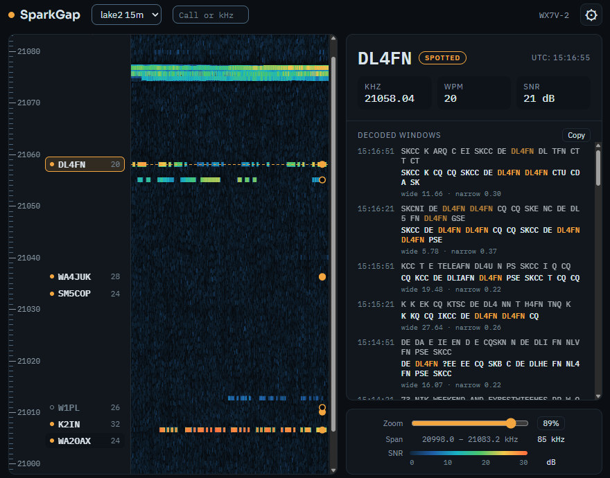
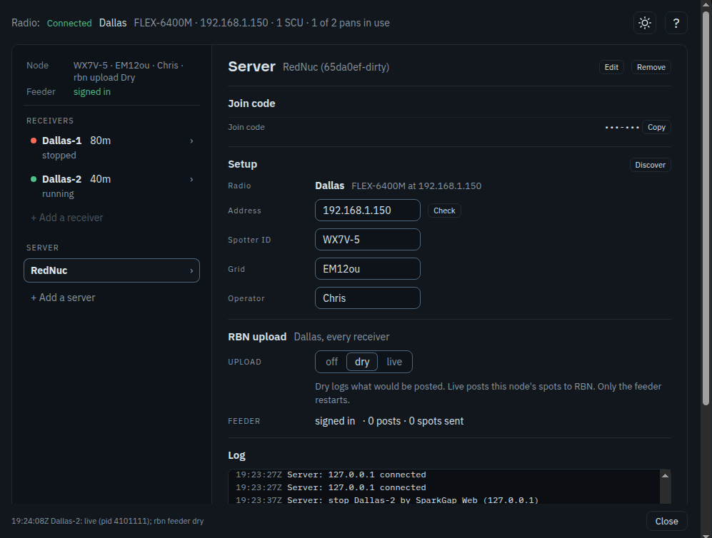
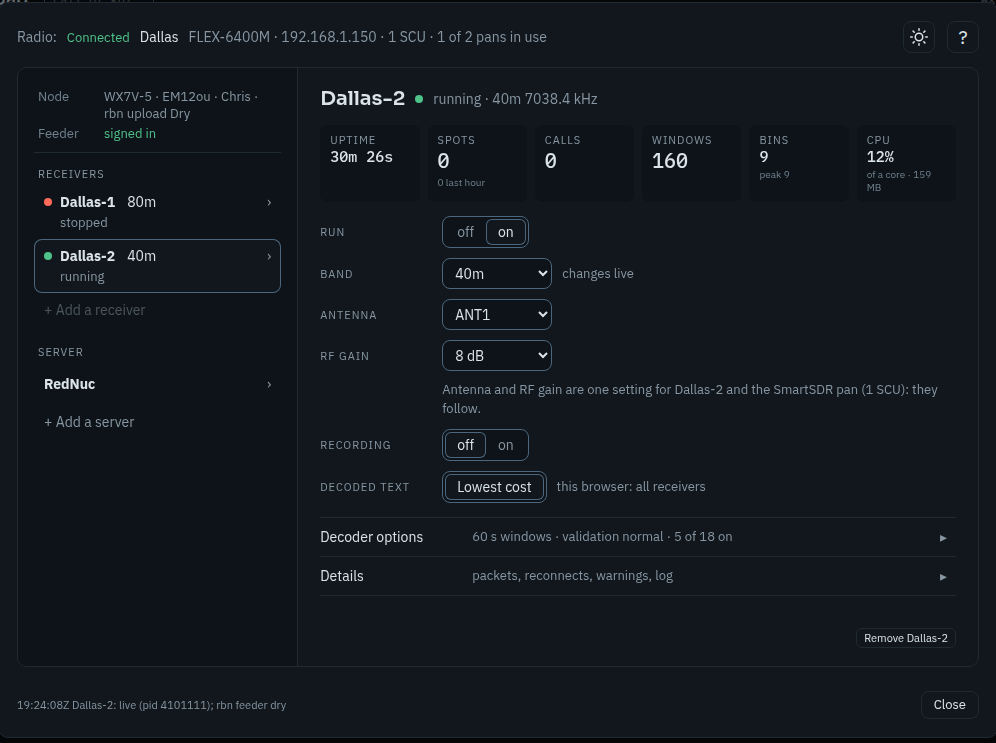

# SparkGap Web (experimental)

SparkGap Web shows your SparkGap receivers in a web browser. You see the band as
a waterfall, every call SparkGap hears marked by frequency, and the CW it copies
from the station you pick. From the same page you can add, start and stop a
receiver, move it to another band, and change how it spots. Nothing to install:
any browser on your network will do, and closing the page does not affect the
receivers.

## Getting connected

You need two things from whoever set up SparkGap on the radio's computer: the
page's address (for example `http://192.168.1.20:7320/`) and a six-character
join code (for example `KTR-49X`).

1. Open the address in your browser.
2. Click **⚙**, then **+ Add a server**, enter the address and the join
   code, and save.
3. The waterfall starts. If the computer runs more than one receiver, pick
   one from the band list at the top.

The page remembers the server, so next time it opens straight to the
waterfall. A wrong code five times in a row locks your browser out for ten
minutes.

## The main screen

- **Waterfall**: the whole band the receiver listens to. Signals are the bright
  traces.
- **Call ladder**, beside the waterfall: every signal by frequency. Spotted
  calls stand out, calls heard but not spotted are dimmer, and signals with no
  call yet show only their frequency.
- **Decoded text**, on the right: click a trace or a call to see what SparkGap
  copied from that station, newest first, with its frequency, speed and signal
  strength. You can select the text, or **Copy** all of it. With both readings
  shown, the one SparkGap is surer of (the lower timing cost) is in bold; a
  reading that copied nothing shows as *(nothing decoded)*.
- **Switching receivers**: each receiver comes back on the signal you last
  picked on it. Two receivers that hear the same frequency (two antennas or
  radios on one band) keep the same signal, so you can compare their copy
  back and forth.
- **Search** (Ctrl+F): type a call, some text or a frequency in kHz to jump to
  it. With the ⚙ dialog open, Ctrl+F is the browser's own find instead.
- **Zoom**: drag to move along the band; Ctrl+scroll or pinch to zoom. The
  **Zoom** button steps through the whole band, half and a quarter. Each
  receiver opens at the zoom you last left it at, in this browser.
- **Bottom bar**: the connection (a green dot and Live when all is well;
  **Reconnecting to radio** or **Radio not connected** when the receiver is
  running but its radio is not), how hard the computer is working, how many
  calls the receiver has spotted, and how long it has been running. On the
  right, the server log's newest line; click it to open the log.
- **?** (inside the ⚙ dialog): this guide and what's new.

## Radios and receivers

Click **⚙**. The top line shows the radio: **Connected**, **Connecting**,
**Reconnecting** or **Not connected**, its model, address and pans in use.
The left side lists each server's radios. Under each radio:

- **Node**: the spotter ID, grid and operator its spots go out under, and
  whether RBN upload is off, dry or live.
- **Feeder**: what sends those spots to RBN, and whether it is signed in.
- **Receivers**: each one with its band and state. Click one to see its
  settings on the right.
- **+ Add a receiver**: pick a free DAX-IQ channel and a band, check the
  recording and decoder options, and Apply. The receiver starts at once.

Below the radios, **Server** holds the join code, Setup, RBN upload and the
server's log.

A receiver's settings:

- To change a setting, pick the new value. A bar at the top lists the changes
  not applied yet, with **Apply** (it says whether the change is live or
  restarts, starts or stops the receiver) and **Discard**. You can change
  several at once; they take effect together.
- **RUN**: on starts the receiver, off stops it.
- **BAND**: changes straight away while the receiver runs, in about a
  second, and the waterfall starts over on the new band. A receiver set up to
  listen at an exact frequency rather than a band shows that frequency first
  in the list, for example `7038.0 kHz`; picking a band name moves it to that
  band.
- **ANTENNA** and **RF GAIN** (FlexRadio, while the receiver runs): as the
  radio has them right now, however they were set: here, in SmartSDR or
  Maestro, or by another receiver. They follow the radio within a couple of
  seconds, and a change here goes to the radio straight away. The receiver
  starts with the antenna and RF gain set in its config, or the radio's where
  none is set.
- Antenna, loops and RF gain are shared: on a FlexRadio, every panadapter on
  the same receiver (SCU) has the same antenna and RF gain, and the radio
  decides which SCU a panadapter uses. Changing one receiver can change
  another, or an operator's panadapter in SmartSDR or Maestro.
- **RECORDING**: restarts the receiver.
- **DECODED TEXT**: SparkGap reads each signal twice, through a wide and a
  narrow filter. **Lowest cost** (the default) shows whichever it is surer of;
  you can show both, or only one. This is for this browser, all receivers.
- **Decoder options** (click to open): the decode window, call validation,
  the known call list, AFC and the spot rule's options. The line beside it
  sums them up. Changes restart the receiver. **Reset to defaults** goes back
  to the shipped settings.
- **Window**: how much signal each decoded window holds. Shorter windows show
  text sooner but give the decoder less signal to work from and use more
  CPU; 15 and 7.5 s are untried.
- **Details** (click to open): health, packets, reconnects, recent warnings
  and errors.
- **Remove**: stops the receiver and takes it off the radio's list, on
  Apply. Its config, logs and recordings stay; adding the same receiver again
  brings its settings back.

Settings, in plain terms:

- **Recording**: saves the raw signal to disk so it can be replayed later. It
  uses a lot of space (it needs at least 5 GB free); leave it off unless you
  were asked to record.
- **Call validation**: how sure SparkGap must be before it spots a call.
  Permissive spots more calls but gets more wrong; aggressive spots fewer but
  surer ones. Normal suits most stations. Off uses no score: a call is spotted
  once it is copied a set number of times (2, 3 or 4, by how common its
  pattern is), and the known call list is not used.
- **AFC**: each signal's decoder follows the signal's own tone, which helps
  weak signals and ones slightly off tune. Changing it restarts the receiver.
  It acts only with the itila2 decoder and is greyed out with any other.
- **Known call list**: calls on this list count as more likely to be right.
  SCP is the contest call list; RBN adds calls other RBN skimmers heard in the
  past week; RBN + SKCC adds the SKCC roster, good for hand-keyed CW.
- **Spot rule options**, under Decoder Options: each changes which calls are
  spotted. All are off unless set. A config with `local_spot_rule` keeps its
  own validation and spot rule for the local port, which these settings do not
  change. Some spot more calls with some risk of a wrong one:
  - **Split runs**: reads `CQCQDE` as `CQ CQ DE`, for fists that run words
    together.
  - **Contest words**: treats CWT, SST or MST before a call like CQ, for
    runners who skip the CQ.
  - **CQ repeats**: spots a station sooner when it sends CQ several times in a
    row.

  Others keep wrong calls out, such as **Owner listed**, **Fragments** and
  **Strongest copy**. **Decoder SNR** measures a spot's signal the way CW
  Skimmer does.

Hover over a setting for a one-line reminder.

## When something looks wrong

- **The Radio line** at the top of ⚙ says whether SparkGap holds the radio:
  - **Connecting**: starting; it turns Connected within a few seconds.
  - **Reconnecting**: SparkGap lost the radio (rebooted, off the network)
    and reconnects by itself once the radio has answered steadily for a
    minute. If it stays this way, check the radio and its network cable.
  - **Not connected**: no receiver runs on the radio, or SparkGap gave up
    after 10 minutes. Fix the radio, then turn the receivers' **RUN** on.
- **The server's log** (⚙, **Server**, Log): every start, stop and setting
  change with its result, radio connection changes, and every warning and
  error from the receivers, the station and the feeder. It is the first thing
  to look at, and the thing to send along when asking for help.
- **A receiver's Details** start with a line: green means the radio is live
  and decoding keeps up. Otherwise it says what is wrong, worst first:
  - **Radio reconnected**: SparkGap lost the radio for a moment, usually a
    network hiccup, and reconnected by itself.
  - **Decoder behind**: the computer is too busy to keep up. Close other
    programs, or run fewer receivers.
  - **Clock not NTP synchronised**: the computer's clock is not set from the
    internet. Spot times will be off; turn on automatic time.
- **A stopped receiver** shows its last error under its name. Turn **RUN**
  on; if it stops again, send the message to whoever set it up.

On a FlexRadio, Details also show the receiver's slice (with the letter
SmartSDR shows), its antenna and RF gain as the radio has them, and its
DAX-IQ channel.

## This browser

- **Theme**: the sun button at the top of ⚙, dark or light.
- **Decoded text**: in each receiver's settings; it applies to every
  receiver in this browser.

## What's new

- **2026-11-05.** The ⚙ dialog is Radios: each radio with its node, feeder
  and receivers, and **+ Add a receiver** under it; Remove keeps a receiver's
  settings for the next Add. The Radio line and the bottom bar say
  **Connecting**, **Connected**, **Reconnecting** or **Not connected** as the
  radio is, and the server's log has every warning and error from the
  receivers, station and feeder. Receivers added here take telnet 7330 plus
  their DAX-IQ channel, clear of the RBN Aggregator's 7300.
- **2026-11-04.** SparkGap follows the radio: a running skimmer takes antenna,
  RF gain and loop changes from here, SmartSDR, SmartControl or the radio, and
  keeps them across a reconnect. Save Config is gone.

- **2026-10-28.** The radio card follows the radio: antenna, RF gain and
  loops changed in SmartSDR, Maestro or by another skimmer show within a
  couple of seconds. **Startup Config** shows what a skimmer starts with, and
  **Save Config** saves the radio's current values. A change here no longer
  changes the config by itself. Info shows the slice, antenna and DAX-IQ
  channel; a stopped skimmer shows its cards empty. AFC moved to the top card.
  Removing a server asks first.
- **2026-10-27.** The surer of the two readings is in bold, and a reading that
  copied nothing says so. AFC can be switched per skimmer. Each skimmer keeps
  the signal you last picked on it. Ctrl+F finds text inside the ⚙ dialog.
  A band change clears the old signal. The ⚙ dialog has its own **?** for
  help and this list. A skimmer's settings are in three cards (the skimmer
  with Apply, Radio, Decoder Options) with more of the decoder's options, and
  the Servers tab starts and stops skimmers.
- **2026-10-26.** Spots, not consoles, in the bottom bar; a band change
  counts spots and calls from zero.

## Setting it up

Installing SparkGap and its server, addresses, join codes and remote access are
in [SERVER_SETUP.md](SERVER_SETUP.md). Sending spots to RBN:
[sending-spots.md](sending-spots.md).
